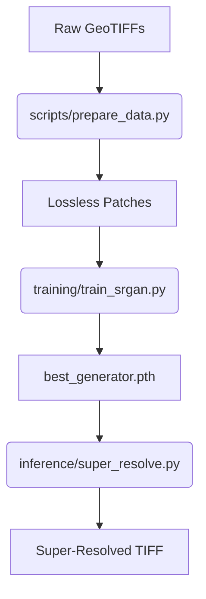
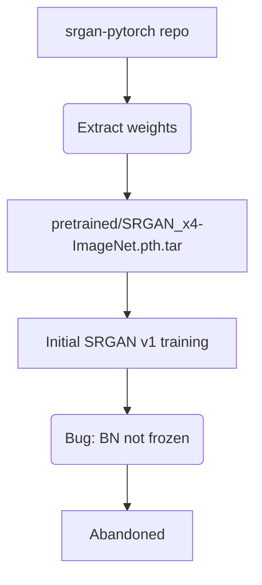

# Satellite Image Super-Resolution Project — Complete Technical Guide
This document is a comprehensive guide to the satellite image super-resolution project. It explains the project's purpose, dataset, machine learning models, training processes, evaluation, and inference mechanisms. It is designed to teach the project from an absolute beginner level to deep implementation details.

## Executive Summary
This project tackles the problem of **Satellite Image Super-Resolution**. "Super-resolution" is the process of taking a low-resolution (blurry or pixelated) image and reconstructing a high-resolution, sharp version of it. In satellite imagery, acquiring high-resolution images is expensive and constrained by satellite optics. By using ML models to artificially upscale lower-resolution images, we can extract better details for mapping and analysis.

**Conceptual Flow:**
`Low-resolution satellite image -> Super-resolution model -> High-resolution reconstructed image`

The project compares multiple approaches:
*   **Bicubic Interpolation**: A standard, non-learned mathematical baseline.
*   **CNN (Convolutional Neural Network)**: A baseline learned model optimizing pixel-level fidelity.
*   **SRGAN (Super-Resolution Generative Adversarial Network)**: An advanced model generating realistic textures.
    *   **Pretrained SRGAN**: The SRGAN model loaded with third-party weights (from ImageNet).
    *   **Fine-tuned SRGAN**: The SRGAN trained specifically on our satellite imagery dataset.

## Project Goals
### Primary Goal
To evaluate and compare a CNN baseline against a fine-tuned SRGAN for 4× super-resolution reconstruction of real satellite imagery.

### Secondary Goals
*   Compare pixel-level metrics (PSNR, SSIM) against perceptual metrics (LPIPS).
*   Evaluate the trade-off between factual pixel reconstruction (CNN) and perceptual texture hallucination (GAN).
*   Provide a robust pipeline for evaluating structural edges and alignment in upscaled satellite images.

## Beginner Concepts
### 1. Image Resolution
An image is made of pixels. **Spatial resolution** in satellite imagery is often measured in meters/pixel. A "low-resolution" image covers more area per pixel (e.g., 2m/pixel), while a "high-resolution" image captures finer details (e.g., 0.5m/pixel).
### 2. Super-Resolution
The task of converting a low-resolution (LR) image into a high-resolution (HR) one. The **scaling factor** here is 4×, meaning the image width and height are quadrupled (a single pixel becomes a 4×4 grid of 16 pixels). Normal resizing just stretches the image; true super-resolution tries to predict the missing details.
### 3. Interpolation
Basic math techniques like **nearest-neighbor** (copying pixels) or **bicubic** (smoothing curves between pixels) to resize images. These are baselines, not ML models, and they produce blurry or blocky results.
### 4. CNN (Convolutional Neural Network)
A network that uses **filters** (sliding windows) to detect patterns (edges, textures). A CNN learns to transform the LR feature maps directly into HR feature maps to minimize the pixel-by-pixel difference (reconstruction).
### 5. GAN (Generative Adversarial Network)
A system with two models competing:
*   **Generator**: Tries to create realistic high-resolution images.
*   **Discriminator**: Tries to tell the difference between real high-resolution images and fake ones produced by the generator.
### 6. SRGAN
A specific GAN architecture for super-resolution. It uses a **reconstruction loss** (keep it looking like the original), a **perceptual loss** (match high-level feature activations in a VGG network), and an **adversarial loss** (fool the discriminator).
### 7. Perceptual Reconstruction
An image can have a high PSNR (mathematically close pixels) but look blurry. Another image can have a lower PSNR (pixels are technically wrong) but look incredibly sharp and realistic. This is the difference between pixel reconstruction and perceptual reconstruction.
### 8. Hallucination
When a GAN "hallucinates," it invents plausible details (e.g., roof tiles, tree branches) that weren't actually in the low-resolution image. For satellite images, this is risky because the hallucinated objects might not actually exist on the ground.

## Complete Project Architecture
```text
Main/
├── checkpoints/       # Trained model weights (cnn/, srgan/, pretrained/)
├── configs/           # YAML configuration files (base.yaml, cnn.yaml, srgan.yaml, data.yaml, etc.)
├── docs/              # Documentation, experiment logs, final report, history
├── evaluation/        # Scripts for calculating metrics and visual comparisons
├── inference/         # Code to run models on new images (super_resolve.py)
├── losses/            # Implementations of adversarial, perceptual, and pixel losses
├── models/            # Neural network architectures (CNN, SRGAN Generator/Discriminator)
├── results_final/     # Final metrics, reports, plots, and gallery images
├── scripts/           # Entry points for data prep, evaluation, and reporting
├── sr_datasets/       # Dataset loading, patching, degradation, and IO logic
├── tests/             # PyTest unit tests
└── utils/             # Helpers for config, logging, seeding, image manipulation, checkpoints
```
*   **`configs/`**: The central brain for hyperparameters.
*   **`sr_datasets/`**: Everything data-related (GeoTIFFs -> Tensors).
*   **`models/` & `losses/`**: Core ML logic.
*   **`training/`**: Training loops.
*   **`inference/` & `evaluation/`**: Running the models and grading them.

## Codebase Deep Dive

### `models/cnn_sr.py`
*   **Purpose**: The baseline CNN model.
*   **Architecture**: Follows an EDSR-lite style. Contains a sequence of 16 `_ResidualBlock`s. It uses 64 channels, Parametric ReLU (PReLU) activations, and NO Batch Normalization. Upsampling is done via a single Conv2d layer with a stride/padding setup, followed by a final convolution.
*   **Inputs**: LR Tensor (B, 3, H, W).
*   **Outputs**: HR Tensor (B, 3, 4H, 4W).

### `models/srgan_generator.py`
*   **Purpose**: The generator for the SRGAN.
*   **Architecture**: Implements the SRResNet architecture. Contains 16 `_ResidualConvBlock`s which *do* use Batch Normalization. Upsampling uses `_UpsampleBlock` which relies on `PixelShuffle`.
*   **Inputs/Outputs**: Same as CNN.

### `models/srgan_discriminator.py`
*   **Purpose**: The discriminator for adversarial training.
*   **Architecture**: VGG-style architecture. A sequence of Conv2d -> BatchNorm -> LeakyReLU layers that progressively halve the spatial dimensions and double the channels (up to 512 channels). The output is flattened and passed through two Linear layers.
*   **Input**: (B, 3, 96, 96) minimum image size.
*   **Output**: (B, 1) logits indicating real vs. fake.

### `sr_datasets/sr_dataset.py`
*   **Purpose**: PyTorch Dataset implementation.
*   **Classes**: `SRDataset` loads stored patches (lossless .npy or .png) based on a manifest.csv.
*   **Augmentations**: Applies identical random geometric transforms (flips, 90-degree rotations) to both HR and LR patches during training.
*   **Inputs/Outputs**: Returns dict `{"lr": LR_tensor, "hr": HR_tensor, "name": patch_name}`.

### `sr_datasets/degradation.py`
*   **Purpose**: Creates LR images from HR images.
*   **Process**: Uses PyTorch's `bicubic` interpolation with `antialias=True` to downscale by the scale factor (4). Can optionally add noise or JPEG compression.

### `training/train_cnn.py` & `training/train_srgan.py`
*   **Purpose**: Main training loops.
*   **CNN**: Uses L1 loss. Backpropagates to update the CNN weights. Uses Cosine Annealing scheduler.
*   **SRGAN**: Multi-stage. First, `pixel_warmup` using only L1 loss on the Generator. Second, `gan` stage which uses `VGGPerceptualLoss`, `PixelLoss` (L1), and `GANLoss` (BCEWithLogits). It alternates updates between Generator and Discriminator.

### `inference/super_resolve.py`
*   **Purpose**: Runs super-resolution on full arbitrary images.
*   **Process**: Since satellite images are massive, it uses a **tiled inference** approach with feathering/overlap to prevent boundary seams, optionally using AMP (Automatic Mixed Precision).

### `losses/perceptual.py`
*   **Purpose**: Calculates perceptual loss.
*   **Process**: Loads a pretrained VGG19 model, freezes it, extracts features from a specific layer (layer 35), and calculates the MSE difference between the HR and SR feature maps.

### `utils/config.py`
*   **Purpose**: Immutable, deeply merged configuration system. Loads YAMLs and handles inheritance (e.g., `_base_: configs/base.yaml`).

## Dataset
*   **Source**: The dataset contains 360 valid paired satellite tiles across 10 cities.
*   **Formats**: Original images are GeoTIFFs (with geographic metadata). Processed patches are lossless `.npy` or `.png`.
*   **Dimensions**: HR imagery is approx 3000×3000 (0.5m resolution). LR is approx 750×750 (2m resolution). Scale factor is 4×.
*   **Splits**: Train/Validation/Test at 70/15/15 ratio, stratified by city to ensure diverse geographic representation.
*   **Test Patches**: The processed test split contains exactly 6,050 patches.
*   **Provenance**: Data is dynamically processed from raw HR tiles using `scripts/prepare_data.py`.

## Data Types and File Formats
*   **GeoTIFF (`.tif`)**: Source format, contains channels, bit depth (usually uint8/uint16/float), CRS, and Nodatas.
*   **Numpy arrays (`.npy`)**: Used for lossless intermediate storage of patches. Faster to load. Stored as uint8 [0, 255] and normalized to [0, 1] float32 upon loading.
*   **PNG**: Alternative lossless patch storage format.

## Data Pipeline
1.  **Raw dataset**: Large HR/LR GeoTIFF tiles.
2.  **Raster/image loading**: Read via `tifffile` (`raster_io.py`), normalized based on dtype.
3.  **Validation**: `validation.py` checks sizes, nodata fractions, and bands.
4.  **Train/validation/test split**: `splits.py` separates tiles by city.
5.  **Patch extraction**: `patching.py` extracts 256x256 HR patches using a sliding window.
6.  **Degradation**: If real LR is not provided, HR is downsampled bicubically (`degradation.py`).
7.  **Storage**: Patches are saved to disk.
8.  **Model Loading**: `sr_dataset.py` loads pairs, augments them, and converts to tensors in [0, 1].

## Patching
Satellite images (e.g., 3000x3000px) cannot fit in GPU memory. They are cropped into **patches** (256x256 HR pixels).
*   **Size**: HR patch size is 256. LR patch size is 64.
*   **Stride/Overlap**: Configurable (e.g., stride 128 means 50% overlap).
*   **Edge cases**: Patches with high nodata fractions or very low standard deviations (blank regions) are filtered out.

## Image Degradation
If synthetic degradation is used (config `lr_source: synthetic`), the pipeline:
1.  Takes HR (256x256)
2.  Applies PyTorch `functional.interpolate` with `mode="bicubic"` and `antialias=True` to downscale to LR (64x64).
3.  (Optional) adds Gaussian noise or JPEG compression.
This simulates the optical limitations of lower-resolution satellite sensors.

## Data Splits
Data is split at the **Tile level**, not the patch level.
*   **Why?**: If we split by patches, an HR patch in the training set might overlap with an HR patch in the test set. The model would memorize it (data leakage).
*   **Geographic Stratification**: Each city gets a 70/15/15 allocation of tiles to ensure the model learns global features, not just one city's architecture. Seed=42 is used for deterministic splitting.

## Models
| Model | Type | Input | Output | Scale | Main Loss | Purpose |
|---|---|---|---|---|---|---|
| Bicubic | Interpolation | 64x64 | 256x256 | 4x | None | Baseline non-learned upscaler |
| CNN | ResNet | 64x64 | 256x256 | 4x | L1 (Pixel) | Baseline for exact pixel fidelity |
| SRGAN | GAN | 64x64 | 256x256 | 4x | L1 / VGG / BCE | Advanced model for sharp textures |

### Pretrained SRGAN
*   **Source**: Weights initialized from `srgan-pytorch` (ImageNet).
*   **Why**: It knows how to upsample natural images (dogs, cars), giving it a head start.
*   **Domain Mismatch**: ImageNet looks nothing like top-down satellite imagery, causing weird artifacts.

### Fine-tuned SRGAN
*   **Process**: Started from Pretrained SRGAN weights. Trained on our satellite data.
*   **Result**: Adapts the ImageNet knowledge specifically to roofs, roads, and vegetation.

## Model Architecture in Detail

### CNN (EDSR-lite)
`Input(B, 3, 64, 64) -> Conv2d -> [_ResidualBlock x 16] -> Conv2d -> + Skip Connection -> PixelShuffle(Upsample x4) -> Conv2d -> Output(B, 3, 256, 256)`
*   Uses no Batch Normalization (preserves range flexibility).
*   Optimizes heavily for pixel-perfect reconstruction.

### SRGAN Generator (SRResNet)
`Input -> Conv2d -> [_ResidualConvBlock x 16] -> Conv2d -> BatchNorm -> + Skip Connection -> _UpsampleBlock x 2 (PixelShuffle) -> Conv2d -> Output`
*   Uses Batch Normalization inside residual blocks.

## Training Configuration
| Parameter | Value | Meaning / Why |
|---|---|---|
| Epochs | 30 (CNN), 2+8 (SRGAN) | CNN trains for 30. SRGAN has 2 warmup epochs, 8 GAN epochs. |
| Batch Size | 2 / 16 / etc. | Number of patches processed at once. Configurable per hardware. |
| Optimizer | Adam | Standard adaptive optimizer (lr=2e-4 for CNN, 1e-5 for GAN). |
| Scale Factor| 4 | Output is 4x larger than input in both H and W. |
| Device | cuda / auto | Uses GPU acceleration for speed. |
| Mixed Precision (AMP) | True/False | Uses FP16 for faster training on modern GPUs. |

## Training Process
### CNN
1. Forward pass LR patch to get SR.
2. Calculate L1 loss against true HR.
3. Backpropagate and update weights.
### SRGAN
**Phase 1 — Pixel Warmup**: Train Generator using only L1 loss to get basic shapes right.
**Phase 2 — GAN Training**:
1. Generator makes SR from LR.
2. Discriminator evaluates real HR and fake SR.
3. Discriminator is updated (Loss: BCE on Real + BCE on Fake).
4. Generator is updated (Loss: 0.01 * L1 + 1.0 * VGG Perceptual + 0.001 * Adversarial BCE).

## Loss Functions
*   **PixelLoss (L1/L2)**: Measures average absolute/squared difference between pixels. Good for PSNR, but produces blurry images because it averages out uncertain high-frequency details.
*   **VGGPerceptualLoss**: Compares images deep inside a VGG network. Forces the SR image to have the same "features" (edges, textures) as the HR image, improving visual sharpness.
*   **GANLoss**: Adversarial BCE loss. Forces Generator to create images that the Discriminator classifies as "real".

## Checkpoints
*   `best.pt` / `best_generator.pth`: Saved when the validation metric (PSNR for CNN, LPIPS for SRGAN) improves. Contains only the model state for inference.
*   `last.pt` / `last_gan.pt`: Saved every epoch. Contains model state, optimizer state, scaler, epoch number, and random states. Used for **resuming** interrupted training.

## Experiment History
*   `smoke_*`: Rapid 1-epoch runs to verify pipeline integrity.
*   `cnn_gpu` / `srgan_gpu`: Initial full runs. However, bugs were found (e.g., BN not frozen properly, batch size issues).
*   `cnn_v2` / `srgan_v2`: Reruns with updated configurations to fix bugs.
*   `cnn_v2_fixed` / `srgan_v2_fixed`: Final authoritative runs resulting in the definitive metrics.

## Evaluation
Pipeline:
1. Load test dataset patches.
2. Generate SR predictions (using FP32 or FP16).
3. Align SR/HR (optionally, but metrics assume perfectly aligned patches).
4. Crop a 4-pixel border to ignore edge artifacts.
5. Calculate PSNR_Y, SSIM_Y, and LPIPS per image.
6. Aggregate into CSVs and compute bootstrap significance intervals.

## Metrics
### PSNR (Peak Signal-to-Noise Ratio)
Measures pixel-perfect reconstruction error using MSE.
*   **Unit**: Decibels (dB).
*   **Interpretation**: Higher is better (less noise/error). Standard for CNNs.
### SSIM (Structural Similarity Index Measure)
Measures structural integrity (luminance, contrast, structure).
*   **Range**: -1 to 1.
*   **Interpretation**: Higher is better. Focuses on spatial relationships.
### LPIPS (Learned Perceptual Image Patch Similarity)
Measures perceptual similarity using a pretrained AlexNet.
*   **Interpretation**: **Lower is better**. Mimics human vision. GANs excel here.

*Note: PSNR_Y and SSIM_Y convert RGB to a single Luma (Y) channel before calculation.*

## Actual Results
| Method | PSNR_Y | SSIM_Y | LPIPS |
|---|---:|---:|---:|
| bicubic | 25.7540 | 0.6782 | 0.5507 |
| cnn (v2) | 28.2694 | 0.7918 | 0.3109 |
| srgan_pretrained | 26.8227 | 0.7277 | 0.2102 |
| srgan_v2_finetuned | 26.1871 | 0.7146 | 0.1387 |

**Trade-offs**: CNN wins on PSNR (28.26 vs 26.18) because it optimizes for pixel averages. SRGAN wins massively on LPIPS (0.1387 vs 0.3109) because it hallucinates realistic high-frequency textures.

## Statistical Analysis
Bootstrap resampling (5000 resamples) on the 6050 test patches confirms that the differences between the models are statistically significant. The 95% Confidence Interval for LPIPS difference (SRGAN finetuned vs CNN) is [-0.1740, -0.1704], strictly excluding zero.

## Hallucination Analysis
**What is it?**: A GAN might draw a sharp, realistic-looking tree branch that *does not actually exist* on the ground.
**Why it matters**: In satellite mapping, hallucinating a non-existent building or road can cause critical errors in downstream tasks like urban planning or disaster response.
**Visualizing**: The `hallucination_gallery.py` script identifies cases where SRGAN has great LPIPS but poor structural fidelity (edge precision) relative to the CNN.

## Visual Comparison
When viewing the output panels:
*   **Bicubic**: Looks blurry and pixelated.
*   **CNN**: Looks smooth but lacks fine textures (e.g., grass looks like green paint).
*   **SRGAN**: Looks incredibly sharp, grass looks like grass, roofs have tiles. However, upon close inspection against the **HR ground truth**, some roof tiles or road lines might be "invented" incorrectly.

## Inference
**Step-by-step for a new image**:
1. Run `python -m scripts.inference --model srgan --checkpoint path/to/best.pth --input image.tif`
2. Script loads the TIFF, normalizes to [0, 1].
3. Because the image is huge, the script breaks it into overlapping tiles (e.g., 512x512).
4. Model performs forward pass on each tile.
5. Tiles are stitched together using a mathematical "feathering window" to blend the overlaps seamlessly.
6. Final output is saved as `image_x4.png`.

## Inference for a Non-Technical Person
Imagine taking a blurry satellite photograph and asking an AI trained on thousands of high-resolution examples to estimate what a sharper version should look like. You feed the AI the blurry photo, it processes it in small chunks (like reading a book paragraph by paragraph), enhances the details using its prior knowledge of how buildings and roads should look, and hands you back a massive, beautiful, highly-detailed image.

## Training vs Inference
| Training | Inference |
|---|---|
| Requires a dataset of LR and HR pairs | Requires only a single LR input image |
| Updates weights via Backpropagation | Does not update weights |
| Calculates loss metrics | No loss calculated |
| Processes small 64x64 patches | Processes massive overlapping tiles |
| Takes hours to days | Takes seconds to minutes |

## End-to-End Pipeline
```text
Raw HR TIFs -> Validation -> Split (Train/Val/Test) -> Patch Extraction -> (HR Patches)
(HR Patches) -> Bicubic Degradation -> (LR Patches)
(LR/HR Pairs) -> DataLoader -> Model -> Losses (L1/VGG/BCE) -> Optimizer Step
Trained Weights -> Checkpoints -> Evaluation -> PSNR/LPIPS -> Final Visuals
New Unseen Image -> Inference Script -> High-Res Output
```

## What Happens to One Image
1. A 3000x3000 image of Berlin is downloaded.
2. `prepare_data.py` cuts it into 256x256 HR patches.
3. It shrinks them to 64x64 LR patches.
4. During training, the SRGAN generator sees a 64x64 LR patch. It predicts a 256x256 image.
5. The Discriminator compares this prediction to the real 256x256 HR patch.
6. The loss tells the generator "You look too blurry, add more texture."
7. Weights are updated. Months later, during inference, the trained generator perfectly sharpens a new 64x64 image of Paris.

## Commands
*   **Prep Data**: `python -m scripts.prepare_data build --config configs/data.yaml`
*   **Train CNN**: `python -m training.train_cnn --config configs/cnn_v2.yaml`
*   **Train SRGAN**: `python -m training.train_srgan --config configs/srgan_v2.yaml`
*   **Evaluate**: `python -m evaluation.evaluate --config configs/evaluation.yaml --methods cnn_v2,srgan_v2_finetuned`
*   **Inference**: `python -m inference.super_resolve --model srgan --checkpoint checkpoints/srgan/srgan_v2_fixed/best_generator.pth --input data/raw/input.tif --output out/`

## Testing
`tests/` contains PyTest files (e.g., `test_models.py`, `test_patching.py`).
Tests ensure that shapes mismatch raise errors, configurations parse correctly, and random seeds are deterministic. A passing test suite proves the software engineering foundation of the pipeline is solid.

## Configuration System
Located in `configs/`. It uses YAML files with an inheritance mechanism (`_base_: configs/base.yaml`). `config.py` recursively merges them, meaning `srgan_v2.yaml` only overrides the specific hyperparameters it wants to change, inheriting standard logging and path logic from `base.yaml`.

## Environment and Dependencies
*   **PyTorch / torchvision**: Core deep learning framework.
*   **tifffile**: Fast read/write of GeoTIFFs.
*   **lpips**: Computes perceptual similarity.
*   **numpy / Pillow**: Image manipulation.
Runs on Python 3.12+ and utilizes CUDA (e.g., RTX 4050 Laptop GPU in logs).

## Reproducibility
The pipeline is highly deterministic. `utils/seed.py` locks Python, Numpy, and Torch random generators (seed=42). Configs are hashed, and Git commits are logged into every checkpoint's metadata to trace exactly what code produced what model.

## Important Design Decisions
*   **SRGAN over ESRGAN**: ESRGAN is more modern, but SRGAN was chosen to baseline the concept of perceptual vs pixel loss cleanly.
*   **Bicubic Degradation**: Chosen over actual atmospheric degradation modeling for simplicity and reproducibility.
*   **Tile-level Splitting**: CRITICAL decision to prevent data leakage between overlapping patches in Train/Test sets.

## Limitations
*   **Synthetic Degradation**: The model learns to reverse bicubic downsampling, not real-world sensor blur. It may underperform on actual raw satellite feeds.
*   **Hallucination Risk**: SRGAN cannot be trusted for critical analytical tasks (e.g., counting cars) because it invents textures.
*   **Dataset Diversity**: Performance is bounded by the 10 cities provided. Generalization to deserts or snow is unknown.

## Failure Modes
*   **CUDA Out of Memory**: Caused by batch size being too high. Fix: lower `batch_size` in config.
*   **Misaligned Patches**: Caused by wrong scale factor config. The evaluation script will flag 0 PSNR.
*   **Checkerboard Artifacts**: Sometimes caused by PixelShuffle upsampling. Fixed by more GAN training.

## Important Files to Never Delete
*   `checkpoints/`: Models take days to train. Do not delete `best*.pt` files.
*   `configs/`: Contains the exact hyperparameters used.
*   `docs/experiment_history.json`: Tracks all historical runs and metrics.

## Final Model
The **`srgan_v2_fixed`** (`best_generator.pth`) is considered the final best model for perceptual quality (LPIPS), while **`cnn_v2_fixed`** is the best model for pixel fidelity (PSNR). Since SRGAN achieves the goal of realistic texture reconstruction (LPIPS: 0.1387), it is the premier model of the repository.

## "If I had to explain this project in an interview"
**30-second**: "I built a PyTorch pipeline that takes low-resolution satellite images and upscales them 4x. I compared a standard CNN that optimizes for PSNR against an SRGAN that optimizes for perceptual quality, finding that the GAN produces much sharper, realistic images at the cost of slight hallucination."

**Why SRGAN?**: CNNs average out uncertainty, producing blurry images. SRGAN uses a discriminator to push the generator into the manifold of real images, creating sharp textures.
**Why LPIPS?**: PSNR penalizes a sharp edge if it's shifted by 1 pixel. LPIPS extracts features using AlexNet and compares them, matching human perception of "sharpness".

## Common Questions and Answers
1.  **What is the project?** A pipeline to super-resolve satellite images by 4x.
2.  **Why satellite images?** High-res satellite images are expensive; ML upscaling is cheap.
3.  **Why CNN?** Serves as a baseline for pixel-perfect reconstruction.
4.  **Why SRGAN?** Generates realistic high-frequency textures (like grass/roofs).
5.  **What is the generator?** The network that hallucinates the high-res image.
6.  **What is the discriminator?** The network that tries to catch the generator's fakes.
7.  **Why use pretrained weights?** Gives the model a head start on understanding edges.
8.  **Why fine-tune?** ImageNet features don't look like top-down satellite roofs.
9.  **What is pixel warmup?** Pre-training the generator with L1 loss so it doesn't feed garbage to the discriminator initially.
10. **Why perceptual loss?** Forces the output to have similar high-level features (edges) to the truth.
11. **Why adversarial loss?** Forces the output to look like a real photograph.
12. **What is PSNR?** Peak Signal-to-Noise Ratio (pixel accuracy).
13. **What is SSIM?** Structural Similarity (luminance/contrast/structure).
14. **What is LPIPS?** Learned Perceptual Similarity (human-like visual quality).
15. **Why is LPIPS lower for SRGAN?** It captures sharp textures, even if not pixel-perfect.
16. **Why can PSNR be lower for SRGAN?** A hallucinated leaf that is off by 1 pixel ruins PSNR.
17. **What is hallucination?** Inventing details that aren't there.
18. **How is HR generated?** Sliced from 0.5m GeoTIFFs.
19. **How is LR generated?** Downsampled mathematically by 4x.
20. **What happens in inference?** The image is tiled, super-resolved, and stitched.
21. **What if the input isn't a multiple of 4?** Tiled inference handles arbitrary sizes.
22. **How do you prevent data leakage?** Splitting by city/tile, not by patch.
23. **Which checkpoint is used?** `best_generator.pth` for inference.
24. **What are the limitations?** Hallucinations make it risky for strict analytics.
25. **Is it reproducible?** Yes, via strict seeds and locked configurations.

## Glossary
*   **HR**: High Resolution.
*   **LR**: Low Resolution.
*   **SR**: Super Resolution (the output of the model).
*   **Patch**: A small cropped square of an image (e.g., 256x256) used for GPU training.
*   **LPIPS**: Learned Perceptual Image Patch Similarity. Lower = Better.

## Source Traceability
*   **Models**: `models/cnn_sr.py`, `models/srgan_generator.py`
*   **Data**: `sr_datasets/sr_dataset.py`, `sr_datasets/patching.py`
*   **Results**: `results_final/metrics/results.csv`
*   **Logs**: `docs/experiment_log.md`

## Known Unknowns
*   **Exact original dataset size**: The raw dataset files are not in the repo, only the processed counts (360 tiles, 6050 test patches) are known from metadata.
*   **External Dataset source**: The original URLs/Licenses for the satellite imagery are marked as `TODO` in the `validation.py` data card generator.

## Final Summary
*   **Project in one sentence**: An end-to-end PyTorch pipeline for 4x satellite image super-resolution comparing CNN pixel-fidelity against SRGAN perceptual quality.
*   **Most important models**: SRResNet (Generator), CNN (EDSR-lite).
*   **Most important metrics**: PSNR (CNN wins), LPIPS (SRGAN wins).
*   **Final result**: `srgan_v2_finetuned` achieves LPIPS of 0.1387.
*   **Biggest limitation**: Hallucination of textures.

## Final vs Historical Code
| Component | Status | Used by final pipeline? | Purpose |
|---|---|---|---|
| `srgan-pytorch/` | Reference | No | External repo used only to supply initial pretrained weights. |
| `configs/srgan.yaml` | Historical | No | Original buggy config. |
| `configs/srgan_v2.yaml` | Final | Yes | Corrected training configuration. |
| `smoke_*` runs | Experimental | No | Used for quick pipeline validation. |
| `cnn_v2_fixed` | Final | Yes | Authoritative CNN weights. |

### Final Pipeline


### Historical Pipeline

